# CardioPulse: Wearable Heart-Sound Monitor (CardioPulseV2)

CardioPulse is the heart-sound stage of a wearable cardiopulmonary monitoring project. A stethoscope chestpiece fitted with an INMP441 MEMS microphone feeds an ESP32-S3, which streams 16 kHz audio and MPU6050 accelerometer data over Wi-Fi to a receiving computer. The computer despikes and band-pass filters the signal, classifies each three-second window as **Normal**, **Murmur**, **Extrasystole** or **Artifact** with an ensemble of a YAMNet-based classifier and a custom CNN, estimates heart rate and the systolic-to-diastolic timing ratio, and shows the results on a live Streamlit dashboard together with a motion-based reliability flag and an activity state.

This repository contains the firmware, the receiving-computer software, the trained models, the data-preparation and validation scripts, and the Colab notebooks used for the B.Sc. thesis described at the end of this page.

## Gallery

<table>
  <tr>
    <td align="center" width="50%">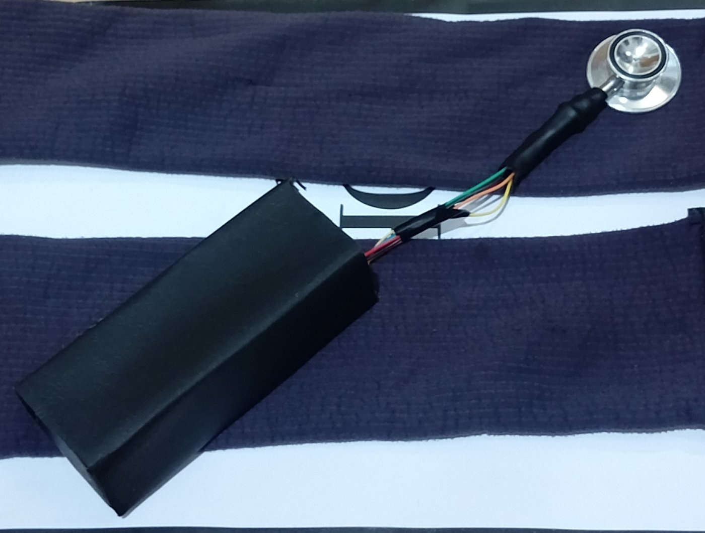<br><sub><b>The prototype:</b> electronics enclosure and stethoscope chestpiece on the elastic chest garment</sub></td>
    <td align="center" width="50%">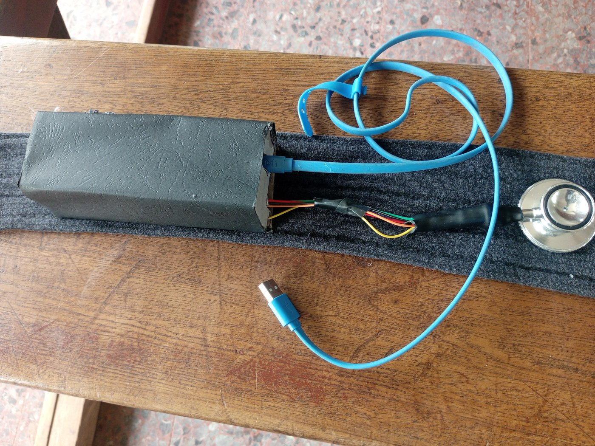<br><sub><b>The device</b> with the stethoscope chestpiece and sealed microphone tubing</sub></td>
  </tr>
  <tr>
    <td align="center">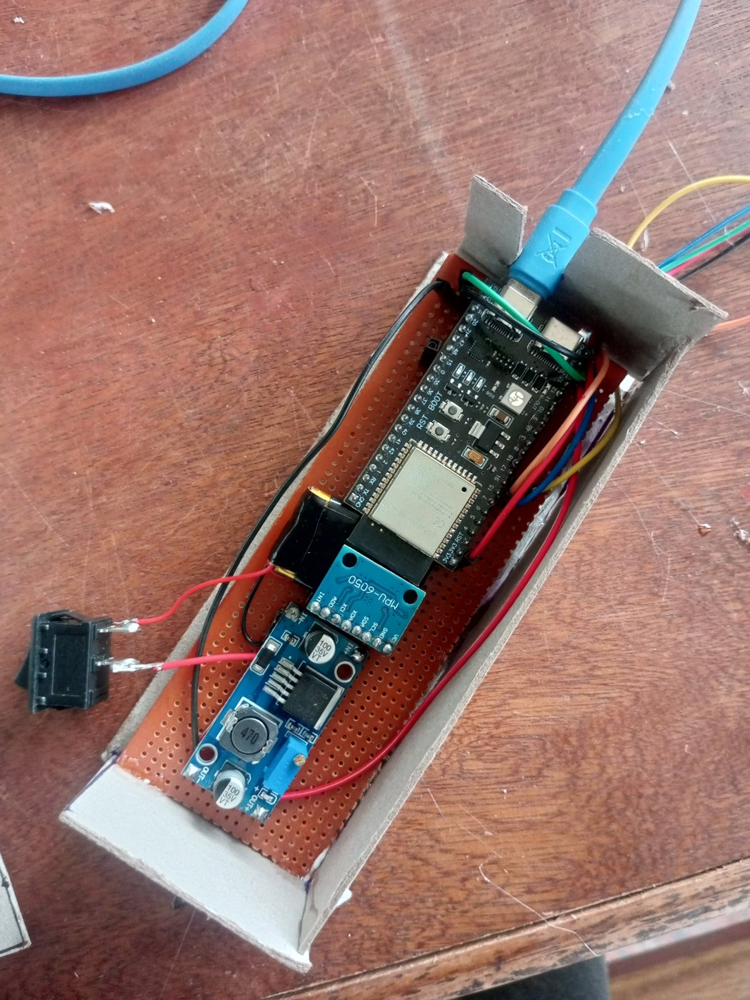<br><sub><b>Inside the enclosure:</b> ESP32-S3, MPU6050 and XL1410 buck converter</sub></td>
    <td align="center">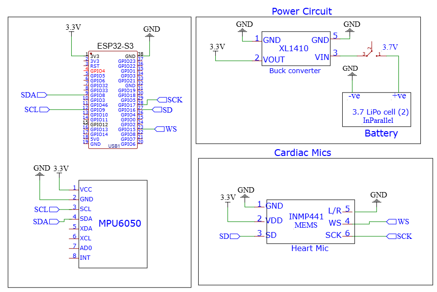<br><sub><b>Circuit schematic</b></sub></td>
  </tr>
</table>

<p align="center">
  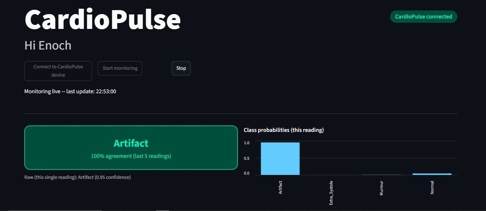<br>
  <sub><b>The live dashboard:</b> classification result, class probabilities, heart rate, S/D timing ratio, signal quality, motion and activity, waveforms and playback</sub>
</p>

> **Important.** CardioPulse is a research prototype. It is not a medical device and must not be used for diagnosis. The classifier was evaluated internally on the PASCAL heart-sound dataset only; its performance on recordings from this device has not yet been tested.

---

## Contents

1. [How the system works](#1-how-the-system-works)
2. [Repository layout](#2-repository-layout)
3. [Hardware](#3-hardware)
4. [Firmware](#4-firmware)
5. [Receiving-computer software](#5-receiving-computer-software)
6. [Using the device](#6-using-the-device)
7. [Testing the software without the hardware](#7-testing-the-software-without-the-hardware)
8. [Reproducing the models and results](#8-reproducing-the-models-and-results)
9. [Script reference](#9-script-reference)
10. [Results summary](#10-results-summary)
11. [Limitations and future work](#11-limitations-and-future-work)
12. [Thesis, citation and licence](#12-thesis-citation-and-licence)

---

## 1. How the system works

<p align="center">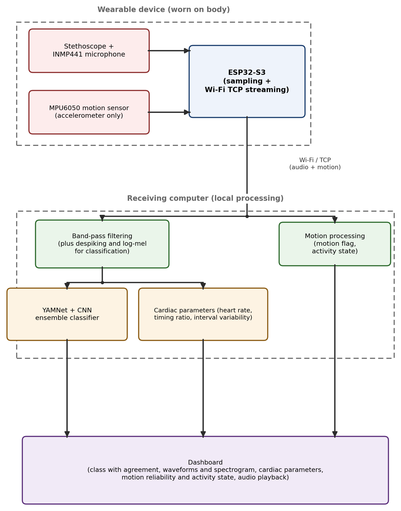</p>

1. **Sensing.** The chestpiece is held at the mitral area (cardiac apex, fifth intercostal space, left midclavicular line) by an elastic garment. Sound travels through sealed tubing to the INMP441 microphone. An MPU6050 in the enclosure over the sternum measures acceleration.
2. **Streaming.** The ESP32-S3 runs its own Wi-Fi access point (`HeartMonitor_ESP32`, IP `192.168.4.1`) and serves two TCP streams: audio on port **3333** (16 kHz, signed 16-bit) and motion on port **3334** (50 Hz).
3. **Preprocessing.** Each window is despiked (samples above 0.95 of full scale in runs of up to three, with neighbours below 30%) and passed through a 20 to 800 Hz fourth-order zero-phase Butterworth band-pass filter.
4. **Classification.** Every 2 s the latest 3 s window is classified. The YAMNet head receives the filtered 16 kHz waveform; the custom CNN receives a 64-bin log-mel spectrogram up to 800 Hz. Their probabilities are averaged with weights 0.95 (YAMNet) and 0.05 (CNN).
5. **Reporting thresholds.** A label is shown only if its probability reaches the class threshold (Normal 0.50, Murmur 0.70, Extrasystole 0.50, Artifact 0.70); otherwise the window is *Uncertain*. The dashboard takes a majority vote over the last five windows and shows "Still gathering a clear signal" when the majority is Uncertain.
6. **Cardiac parameters.** Every 15 s, a 15 s buffer is used to estimate heart rate, the systolic-to-diastolic (S/D) timing ratio, an exploratory cardiac-cycle interval variability value and a heuristic signal-quality score.
7. **Motion.** The motion score is the standard deviation of acceleration magnitude over 2 s (100 samples). Scores are grouped as low (< 0.02 g), moderate (0.02 to 0.10 g) or high (> 0.10 g), and high motion flags the reading as less reliable. The activity state is the 3-minute average score (active above 0.03 g, resting otherwise).

<p align="center">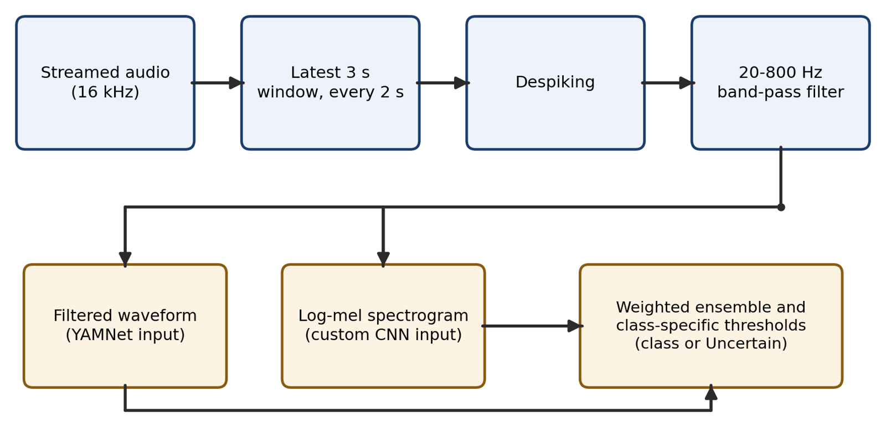</p>
<p align="center">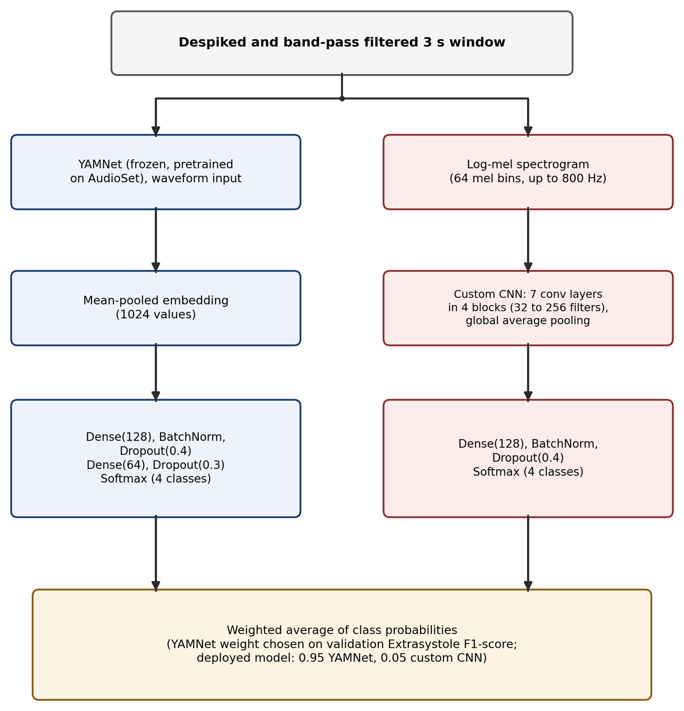</p>

---

## 2. Repository layout

```
CardioPulseV2/
├── Start_CardioPulse.bat        Double-click launcher (Windows)
├── start_cardiopulse.sh         Launcher for macOS / Linux
├── requirements.txt
├── firmware/
│   ├── cardiopulse_firmware/    Deployed firmware: Wi-Fi AP + audio (3333) + motion (3334)
│   ├── wifi_audio_recorder/     Audio-only Wi-Fi AP firmware (used for the Wi-Fi noise clip)
│   ├── usb_audio_recorder/      Audio over USB serial (used for the other noise clips)
│   └── diagnostics/             I2S microphone test, MPU6050 I2C scanner and raw reader
├── cardiopulse/                 All Python code, the deployed models and the noise clips
│   ├── dashboard_live.py        Live dashboard (entry point)
│   ├── final_deployment_*.keras / final_deployment_config.json
│   ├── noise_clips/             Eight device noise recordings used for noise mixing
│   └── ...                      See section 9
├── notebooks/                   Google Colab notebooks (training and evaluation)
│   ├── 1_architecture_search/
│   ├── 2_repeated_runs/
│   │   ├── uniform_overlap/          ensemble_uniform_run1-4
│   │   └── class_specific_overlap/   ensemble_class_specific_run1-4 (run3 = deployed model)
│   ├── 3_hybrid_conv1d_gru/
│   └── 4_report_figures/
└── docs/images/
```

The Python scripts sit together in `cardiopulse/` because they import each other (`spectrogram_utils.py`, `model_inference.py` and so on) and use folder paths relative to that directory. Always run them from inside `cardiopulse/`.

---

## 3. Hardware

### Bill of materials

| Component | Role | Notes |
|---|---|---|
| ESP32-S3 development board | Sampling, Wi-Fi access point, TCP streaming | Programmed with the Arduino IDE |
| INMP441 I2S MEMS microphone | Converts heart sound to digital audio | Sealed inside the stethoscope tubing |
| Acoustic stethoscope chestpiece + tubing | Couples heart sound to the microphone | Held at the mitral area by the garment |
| MPU6050 module | Accelerometer for motion and activity | Only the accelerometer is used |
| 2 × 3.7 V Li-Po cells (in parallel) | Power | No on-board charging; charge the cells off-board |
| XL1410 buck converter | Regulates the supply to 3.3 V | Set to a nominal 3.3 V before connecting the ESP32-S3 |
| Power switch, stripboard, enclosure, elastic chest garment | Assembly | |
| Receiving computer (laptop) | Runs the software and dashboard | Not worn |

### Wiring

| Signal | ESP32-S3 GPIO |
|---|---|
| INMP441 WS (word select) | GPIO 15 |
| INMP441 SD (serial data) | GPIO 16 |
| INMP441 SCK (serial clock) | GPIO 17 |
| INMP441 L/R | GND (left channel) |
| MPU6050 SDA | GPIO 8 |
| MPU6050 SCL | GPIO 9 |
| INMP441 and MPU6050 VDD / GND | 3.3 V / GND |

<p align="center"></p>
<p align="center">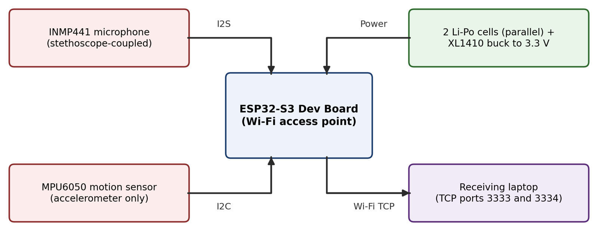</p>
<p align="center">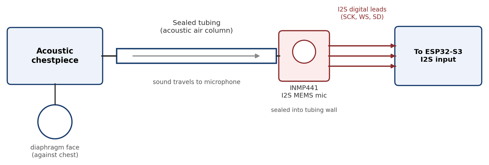</p>

**Assembly notes**

- Seal the INMP441 capsule into the end of the stethoscope tubing so that the chestpiece, tubing and microphone form a closed air cavity. Leaks reduce the heart-sound level and let in room noise.
- Keep the electronics enclosure away from the chestpiece (the prototype places it over the sternum) so that handling the enclosure does not disturb acoustic contact.
- The XL1410 datasheet gives a minimum input of 3.6 V, so there is little headroom with a 3.7 V Li-Po pack. Recharge the cells before a session; low cells can cause dropouts.

---

## 4. Firmware

1. Install the [Arduino IDE](https://www.arduino.cc/en/software).
2. In **Boards Manager**, install **esp32 by Espressif Systems**.
3. Open `firmware/cardiopulse_firmware/cardiopulse_firmware.ino`.
4. Select **Tools → Board → ESP32S3 Dev Module** and the COM port of the board.
5. Upload. No extra libraries are needed (the sketch uses the built-in `driver/i2s.h`, `WiFi.h` and `Wire.h`).
6. Open the Serial Monitor at 115200 baud to confirm that the access point started.

Default settings at the top of the sketch:

```cpp
const char* AP_SSID     = "HeartMonitor_ESP32";
const char* AP_PASSWORD = "heartbeat123";
const uint16_t TCP_PORT_AUDIO  = 3333;
const uint16_t TCP_PORT_MOTION = 3334;
```

If you change the SSID or password, use the new values when joining the network. The Python side expects the ESP32 at `192.168.4.1` (the ESP32 access-point default).

**Troubleshooting sketches** in `firmware/diagnostics/`: `i2s_mic_test` checks that the microphone returns sensible samples, `mpu6050_i2c_scanner` confirms that the MPU6050 answers at address 0x68, and `mpu6050_raw_read` prints raw accelerometer values.

---

## 5. Receiving-computer software

You need **Python 3.12** (3.10 to 3.12 should also work) and an internet connection for the first run only.

### Option A: double-click launcher (recommended)

- **Windows:** double-click `Start_CardioPulse.bat`.
- **macOS / Linux:** open a terminal in the repository folder and run `bash start_cardiopulse.sh`.

On the first run the launcher creates a private Python environment in `.venv/`, installs `requirements.txt` and downloads the YAMNet model into `.tfhub_cache/`. This takes 5 to 15 minutes and must be done **while the computer is still on a normal internet connection**, because the ESP32 network has no internet access. Later runs start the dashboard directly and work offline. The browser opens at <http://localhost:8501>; if it does not, open that address yourself.

When Python is missing, the launcher stops with a message. Install Python from <https://www.python.org/downloads/> and tick **"Add python.exe to PATH"**.

### Option B: manual setup

```bash
# from the repository folder
python -m venv .venv
.venv\Scripts\activate            # Windows
# source .venv/bin/activate       # macOS / Linux
pip install -r requirements.txt

cd cardiopulse
streamlit run dashboard_live.py
```

With the manual route, YAMNet is downloaded from TensorFlow Hub the first time the models are loaded, so the first start must also happen with internet access. Set the environment variable `TFHUB_CACHE_DIR` to a permanent folder if you want the download to be kept between sessions.

---

## 6. Using the device

1. Charge the Li-Po cells and switch the device on.
2. Put on the garment so the chestpiece sits firmly at the mitral area (fifth intercostal space, left midclavicular line).
3. On the laptop, join the Wi-Fi network **HeartMonitor_ESP32** (password `heartbeat123`).
4. Start the dashboard (section 5).
5. Click **Connect to CardioPulse device**. The status badge turns green when both streams are connected.
6. Click **Start monitoring**. Sit still for the first readings; the classification panel fills after five windows (about 10 s) and the cardiac panel after the first 15 s buffer.
7. Click **Stop** to end the session.

**Reading the dashboard**

- **Classification card:** the majority result of the last five windows and the agreement among them. Agreement describes consistency, not clinical reliability. "Still gathering a clear signal" means most recent windows fell below their class threshold.
- **Class probabilities:** the four ensemble probabilities for the latest window.
- **Cardiac panel:** heart rate with a stability label, S/D timing ratio, number of detected candidate peaks and a 0 to 100 signal-quality score (60% heart-rate confidence label, 40% envelope peakedness). Interval variability is exploratory.
- **Motion and activity:** the motion flag for the latest cardiac window and the resting or active state.
- **Signal view and playback:** raw and filtered waveforms, the log-mel spectrogram, the envelope with detected peaks, and audio playback of the raw, filtered and spectrally enhanced versions. The enhanced version is for listening only and is not used by the classifier.

Recordings and temporary analysis files are written to `cardiopulse/saved_recordings/`.

`heart_monitor_terminal.py` is a terminal version of the same live pipeline (no dashboard). Run it from `cardiopulse/` after joining the device network.

---

## 7. Testing the software without the hardware

`test_pipeline_offline.py` runs the classification and cardiac-parameter pipeline on a WAV file as if it were streaming:

```bash
cd cardiopulse
python build_test_audio.py        # joins PASCAL Normal recordings into test_audio_5min_normal.wav
python test_pipeline_offline.py
```

`build_test_audio.py` expects the organised PASCAL data in `cardiopulse/Organized_Heart_Audio/Normal/` (section 8.1).

---

## 8. Reproducing the models and results

### 8.1 Dataset

The classifier was trained on the **PASCAL Classifying Heart Sounds Challenge** dataset (Bentley et al., 2011), available from <http://www.peterjbentley.com/heartchallenge/index.html>. The dataset is not redistributed here.

Arrange the recordings into four class folders inside `cardiopulse/`:

```
cardiopulse/Organized_Heart_Audio/
├── Normal/          Set A normal + Set B normal
├── Murmur/          Set A murmur + Set B murmur
├── Extra_Systole/   Set B extrasystole
└── Artifact/        Set A artifact
```

Set A "extra heart sound" and the unlabelled test recordings are not used. Keep the original PASCAL file names, because the split and validation scripts use them to group chunks by source recording and to tell Set A from Set B. Recordings shorter than 1.5 s produce no chunks and drop out automatically (`check_source_counts.py` lists them); the remaining 542 source recordings are 331 Normal, 125 Murmur, 46 Extrasystole and 40 Artifact.

### 8.2 Chunking and splitting (local, from `cardiopulse/`)

| Configuration | Step 1: chunk into 3 s windows | Step 2: 70/15/15 split by source recording (seed 42) |
|---|---|---|
| Uniform overlap (50% for every class) | `python 1_chunk_uniform_overlap.py` → `chunked_heart_data_v2/` | `python 2_split_uniform_overlap.py` → `split_dataset/` |
| Class-specific overlap (Extrasystole 85%, others 50%), **deployed** | `python 1_chunk_class_specific_overlap.py` → `chunked_heart_data_v3/` | `python 2_split_class_specific_overlap.py` → `split_dataset_v3/` |

`check_split_integrity.py` checks the class-specific split (sample rate, duration and that no source recording appears in more than one split). Short windows are padded by looping real audio, and a trailing window is kept only if at least half of it is real audio.

### 8.3 Training (Google Colab)

The notebooks were run on Colab with a GPU. Each notebook writes its own copies of `spectrogram_utils.py`, `augmentation_utils.py` and `train_data_generator.py`, then unzips a data archive from Google Drive:

1. Create a zip whose top level contains `split_dataset/` and `noise_clips/`:
   - uniform overlap: `split_dataset/` from step 2 → `heart_project_data.zip`
   - class-specific overlap: rename `split_dataset_v3/` to `split_dataset/` inside the zip → `heart_project_data_v3.zip`
   - `noise_clips/` is a copy of `cardiopulse/noise_clips/`
2. Upload the zip to `MyDrive/heart_project/` in Google Drive (the path used in the notebooks), or edit the path in section 1 of the notebook.
3. Run the notebook from top to bottom.

| Folder | Notebooks | Purpose |
|---|---|---|
| `notebooks/1_architecture_search/` | `cnn_architecture_search.ipynb`, `yamnet_and_ensemble_search.ipynb` | Earlier development: baseline CNN, custom CNN, YAMNet head, two-stage and stacking variants, first ensembles. Embedded audio players were removed to keep the files small. |
| `notebooks/2_repeated_runs/uniform_overlap/` | `ensemble_uniform_run1` to `run4` | Final ensemble trained repeatedly on the uniform-overlap split; `run4` also contains the grouped five-fold evaluation |
| `notebooks/2_repeated_runs/class_specific_overlap/` | `ensemble_class_specific_run1` to `run4`, `ensemble_class_specific_with_figures` | The same pipeline on the class-specific split, with the grouped five-fold evaluation. **`ensemble_class_specific_run3_deployed`** produced the deployed models. `ensemble_class_specific_with_figures` adds plotting cells. |
| `notebooks/3_hybrid_conv1d_gru/` | `hybrid_uniform_run1`, `run2`; `hybrid_class_specific_run1` to `run3` | Hybrid YAMNet sequential (Conv1D + bidirectional GRU) model compared with the ensemble |
| `notebooks/4_report_figures/` | `thesis_figures.ipynb` | Figures used in the thesis |

**Deployed model.** The models in `cardiopulse/` come from the **`ensemble_class_specific_run3_deployed.ipynb`** run (class-specific overlap). That notebook saves `final_model_yamnet.keras`, `final_model_deep_cnn.keras` and `final_ensemble_config.json`; these were renamed to `final_deployment_yamnet.keras`, `final_deployment_deep_cnn.keras` and `final_deployment_config.json`. The YAMNet weight of 0.95 was chosen on the validation split by maximising Extrasystole F1 over candidate weights from 0.50 to 1.00.

Training settings (all notebooks): Adam (learning rate 0.001), sparse categorical cross-entropy, batch size 32, up to 40 epochs, early stopping on validation loss (patience 8, best weights restored), learning rate halved on plateau (patience 4, minimum 1e-6), inverse-frequency class weights (Extrasystole weight scaled by 0.7 for the YAMNet head), live augmentation with device-noise mixing at 10 to 20 dB SNR.

### 8.4 Reporting thresholds

Both scripts read `split_dataset/` in `cardiopulse/`. For the deployed model, this folder must hold the **class-specific** split, so copy or rename `split_dataset_v3/` to `split_dataset/` first.

```bash
python calibrate_reporting_thresholds.py       # selects thresholds on split_dataset/val
python evaluate_thresholds_on_test.py   # applies them once to split_dataset/test
```

The second script writes `frozen_threshold_test_results.csv`; the copy in this repository is the result reported in the thesis (409 test chunks).

### 8.5 Heart rate and S/D ratio validation

```bash
python validate_heart_rate.py    # heart rate vs. set_a_timing.csv
python validate_sd_ratio.py          # S/D timing ratio vs. set_a_timing.csv
```

`set_a_timing.csv` holds the PASCAL Set A S1/S2 annotations and is included for this purpose. Both scripts read the Normal recordings from `Organized_Heart_Audio/Normal/`.

### 8.6 Noise clips

`cardiopulse/noise_clips/` holds the eight noise recordings from the device used for noise mixing. The seven other `noise_clip_*.wav` files were recorded over USB serial with `firmware/usb_audio_recorder` and `record_audio_usb.py` (set `COM_PORT` first), and `noise_clip_wifi_transmission.wav` was recorded during Wi-Fi transmission with `firmware/wifi_audio_recorder` and `record_audio_wifi.py`. `batch_check_noise_clips.py` reports level and glitch statistics for the folder, and `cut_audio.py` trims a recording to a time range.

---

## 9. Script reference

All scripts are in `cardiopulse/` and are run from that folder.

| Group | Script | What it does |
|---|---|---|
| **Live system** | `dashboard_live.py` | Streamlit dashboard (main entry point) |
| | `heart_monitor_terminal.py` | Terminal version of the live pipeline |
| | `esp32_streams.py` | TCP receivers for the audio and motion streams; motion score and activity state |
| | `model_inference.py` | Loads the ensemble, applies preprocessing, weights and reporting thresholds |
| | `cardiac_parameters.py` | Heart rate, S/D timing ratio, interval variability and signal quality |
| | `audio_enhancement.py` | Spectral-subtraction enhancement for playback only |
| | `spectrogram_utils.py` | Shared constants, despiking, band-pass filter and log-mel spectrogram |
| **Offline test** | `build_test_audio.py`, `test_pipeline_offline.py` | Builds a 5-minute test file and runs the pipeline on it |
| **Data preparation** | `1_chunk_uniform_overlap.py`, `1_chunk_class_specific_overlap.py` | 3 s chunking (uniform / class-specific overlap) |
| | `2_split_uniform_overlap.py`, `2_split_class_specific_overlap.py` | 70/15/15 split grouped by source recording |
| | `3_generate_spectrograms.py` | Pre-computes validation and test spectrogram arrays |
| | `check_source_counts.py`, `check_split_integrity.py` | Source counts and split integrity checks |
| **Training helpers** | `augmentation_utils.py`, `train_data_generator.py` | Live augmentation, noise mixing and the Keras data generator (also written by the notebooks) |
| **Evaluation** | `calibrate_reporting_thresholds.py`, `evaluate_thresholds_on_test.py` | Reporting-threshold selection and frozen test evaluation |
| | `validate_heart_rate.py`, `validate_sd_ratio.py` | Heart-rate and S/D validation on PASCAL Set A |
| | `bpm_extraction.py`, `check_heart_rate_by_class.py`, `check_heart_rate_set_a_vs_b.py`, `diagnose_heart_rate_set_a_vs_b.py` | Heart-rate development and checks across classes and subsets |
| **Recording** | `record_audio_wifi.py`, `record_audio_usb.py` | Save audio from the device over Wi-Fi or USB serial |
| | `record_combined_audio_motion.py`, `check_motion_stream.py` | Record audio and motion together; motion stream check |
| | `batch_check_noise_clips.py`, `cut_audio.py` | Noise-clip inspection and trimming |
| **Figures** | `visualize_waveforms.py`, `visualize_envelopes.py`, `visualize_spectrograms.py`, `visualize_confusion_matrices.py` | Waveform, envelope, spectrogram and confusion-matrix figures |

---

## 10. Results summary

All figures below are internal evaluations on PASCAL and were not obtained on recordings from the CardioPulse device.

| Measure | Result |
|---|---|
| Mean Extrasystole F1, eight runs (class-specific vs. uniform overlap) | 0.413 vs. 0.183 |
| Mean accuracy, eight runs (class-specific vs. uniform overlap) | 0.679 vs. 0.738 |
| Deployed model with reporting thresholds (fixed test split, 409 chunks) | 56.0% of chunks labelled; 75.1% accuracy among labelled chunks |
| Heart-rate mean absolute error (21 PASCAL Set A recordings) | 2.36 BPM |
| S/D timing-ratio mean absolute error (same recordings) | 0.124 |

<p align="center">
  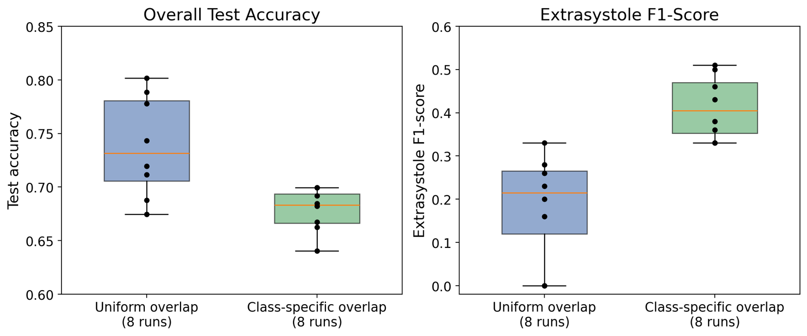<br>
  <sub>Test accuracy and Extrasystole F1-score over eight runs per overlap configuration</sub>
</p>
<p align="center">
  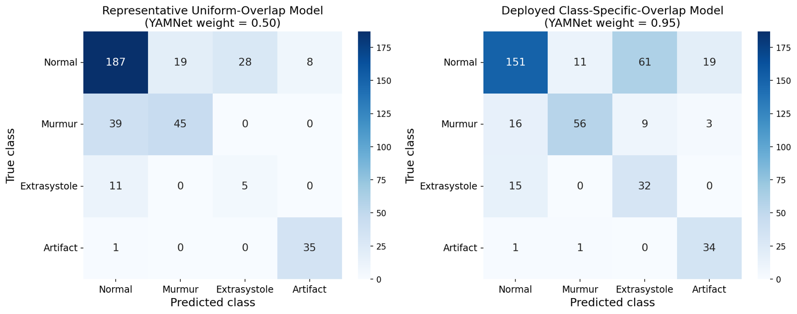<br>
  <sub>Confusion matrices on the test split: a representative uniform-overlap model (left) and the deployed class-specific-overlap model (right)</sub>
</p>
<table>
  <tr>
    <td align="center" width="62%">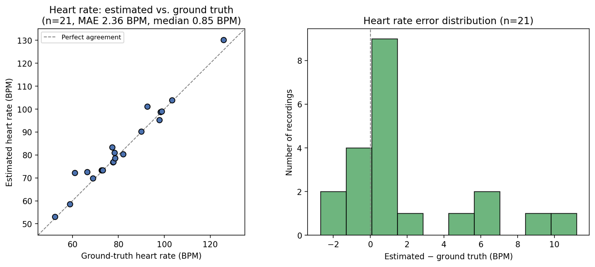<br><sub>Heart rate against PASCAL Set A annotations (n = 21)</sub></td>
    <td align="center" width="38%">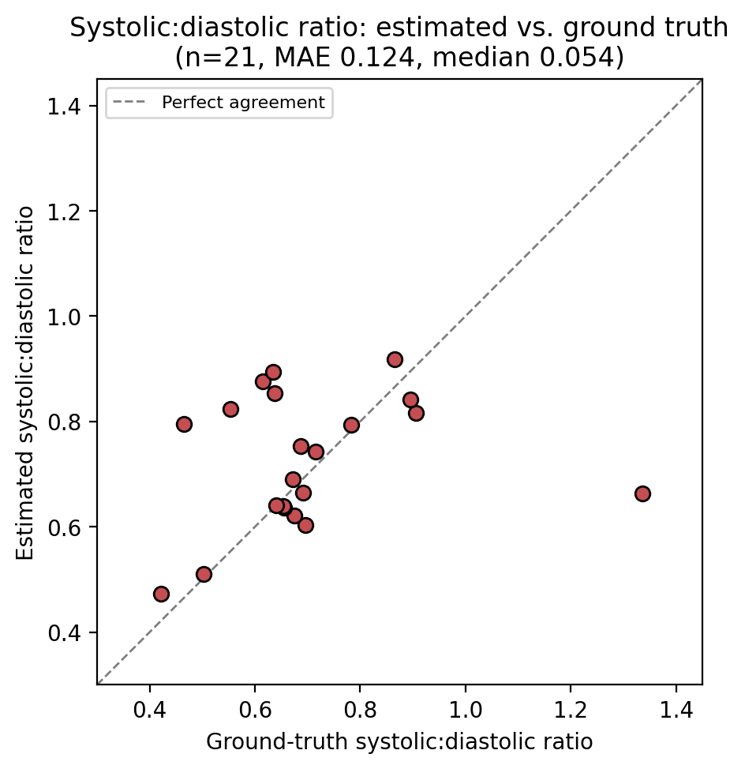<br><sub>S/D timing ratio against annotations (n = 21)</sub></td>
  </tr>
</table>

The higher Extrasystole overlap was applied to the validation and test splits as well as training, so the two configurations differ in the number and correlation of their Extrasystole evaluation windows. The comparison should be read with this in mind.

---

## 11. Limitations and future work

- Classification has only been evaluated on PASCAL. Testing on labelled recordings from the device is still needed.
- The Extrasystole class comes from 46 Set B recordings, and its extra windows are highly correlated.
- The power design leaves little headroom above the buck converter's minimum input voltage.
- Planned work: a lung-sound module using the same acquisition method with the ICBHI 2017 Respiratory Sound Database, and later a single garment combining heart and lung sensing.

---

## 12. Thesis, citation and licence

This work was carried out for the B.Sc. thesis *Design and Implementation of a Wearable Digital Stethoscope for Machine Learning Based Cardiac Diagnostics: A Stage Toward Cardiopulmonary Monitoring* by **Soyinka Enoch Oluwatimilehin** (EEG/2019/079), Department of Electronic and Electrical Engineering, Obafemi Awolowo University, Ile-Ife, Nigeria, under the supervision of **Dr. O. O. Ilori**.

**Dataset.** P. Bentley, G. Nordehn, M. Coimbra and S. Mannor, "The PASCAL Classifying Heart Sounds Challenge 2011 (CHSC2011) Results," 2011. http://www.peterjbentley.com/heartchallenge/index.html

**YAMNet.** Google, YAMNet audio event classifier, TensorFlow Hub: https://tfhub.dev/google/yamnet/1

Released under the MIT License (see `LICENSE`).
